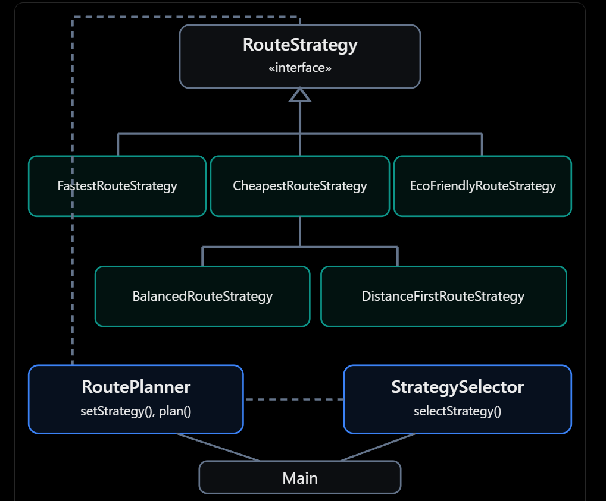
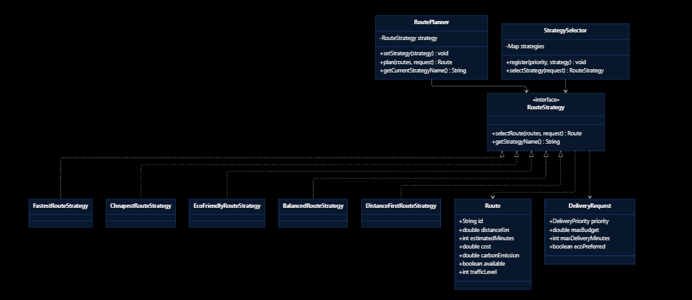
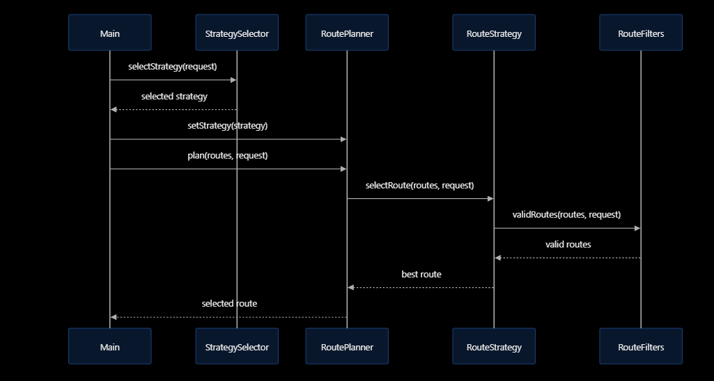

# Assignment 5 — Smart Delivery & Route Optimization Engine

## Project Description

This project is a Java application for selecting delivery routes using the Strategy Design Pattern.

The application supports different delivery priorities and selects the best route based on time, cost, distance, and carbon emissions.

## Technologies

- Java 17
- Maven
- JUnit 5
- IntelliJ IDEA
- Git and GitHub

## Design Pattern

The project uses the **Strategy Pattern**.

`RouteStrategy` is the common interface. Each concrete strategy implements its own route selection algorithm.

`RoutePlanner` is the Context class. It uses a `RouteStrategy` object and supports runtime strategy switching.

## Implemented Strategies

1. **FastestRouteStrategy** — selects the fastest route considering traffic.
2. **CheapestRouteStrategy** — selects the route with the lowest calculated cost.
3. **EcoFriendlyRouteStrategy** — selects a route based on emissions and distance.
4. **BalancedRouteStrategy** — uses configurable weights for multiple criteria.
5. **DistanceFirstRouteStrategy** — selects the shortest valid route.

## Automatic Strategy Selection

The application selects strategies based on delivery priority:

| Priority | Strategy |
|---|---|
| URGENT | Fastest |
| ECONOMY | Cheapest |
| ECO | EcoFriendly |
| STANDARD | Balanced |

## Route Constraints

The application checks route availability, maximum budget, delivery deadline, and validity of numeric route data.

If no suitable route exists, the program throws `NoSuitableRouteException`.

## Cost Calculation

Total cost = Base cost + Distance × 20 + Priority fee.

The urgent priority fee is 500.

## Strategy Comparison

The application can run different strategies using the same delivery request and compare their selected routes.

## How to Run

Run `Main.java` in IntelliJ IDEA.

Alternatively, use Maven to compile and test:

```bash
mvn clean test
```

After compilation, run the main class using the appropriate Java classpath.

## Testing

The project includes JUnit 5 tests for strategy selection, runtime switching, automatic selection, constraints, invalid weights, and failure scenarios.

Add the actual test results after running the test suite.

## SOLID Principles

**SRP:** Each strategy class is responsible for one selection algorithm.

**OCP:** New strategies can be added without modifying RoutePlanner.

**DIP:** RoutePlanner depends on the RouteStrategy interface instead of concrete strategy classes.

## Strategy Pattern — Questions and Answers

**1. Why use Strategy instead of if/else?**

Strategy separates algorithms into different classes and makes the code easier to extend.

**2. What is the Context?**

RoutePlanner is the Context. It stores and uses the current strategy.

**3. What is the Strategy interface?**

RouteStrategy defines the common methods for route selection.

**4. What are Concrete Strategies?**

They are the classes that implement RouteStrategy, such as FastestRouteStrategy and CheapestRouteStrategy.

**5. Can the strategy change at runtime?**

Yes. RoutePlanner provides the setStrategy() method.

**6. How can a new strategy be added?**

Create a class that implements RouteStrategy and implement its methods.

**7. What is the difference between Strategy and Bridge?**

Strategy allows an algorithm to change. Bridge separates an abstraction from its implementation so both can vary independently.

**8. Which SOLID principles are used?**

The architecture demonstrates SRP, OCP, and DIP.

**9. What is one limitation of the architecture?**

The system currently uses predefined candidate routes rather than generating routes from a real road network.

**10. How does the program handle invalid routes?**

RouteFilters rejects routes that violate constraints. If no route is suitable, the program throws an exception.

## UML Diagrams

Insert the Class Diagram and Sequence Diagram Mermaid code from the assignment documentation here.

## Author

Student: [Your name]

Group: [Your group]
